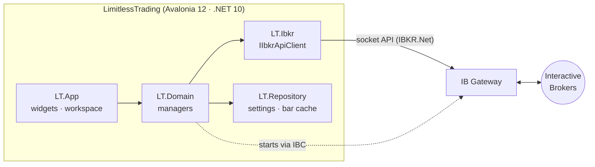

<div align="center">

# ♾️ LimitlessTrading

### Interactive Brokers — TWS, but better.

A fast, calm, cross-platform desktop front-end for Interactive Brokers.<br>
Runs IB Gateway for you, keeps the connection alive and puts everything you watch in one workspace.

[](https://dotnet.microsoft.com/)
[](https://avaloniaui.net/)
[](#-quick-start)
[](#-orders-review-before-send)
[](LICENSE)

[Features](#-features) · [Quick start](#-quick-start) · [How it works](#-how-it-works) ·
[Roadmap](#-roadmap) · [Contributing](#-contributing) · [License](#-license)

</div>

---

## ✨ Features

<table>
<tr>
<td width="50%" valign="top">

**🔌 Connection that just works**
- Logs in to IB Gateway for you (via IBC), including the IB Key 2FA step
- Heartbeat, automatic reconnect with backoff; a Gateway still running is reused on start
- Reuses a Gateway that is already running — optionally keep it alive between runs

</td>
<td width="50%" valign="top">

**📈 Charts**
- Candlesticks from 1 minute to 1 week, several charts side by side
- Historical bars plus live 5-second updates, with a local bar cache
- Ticker box searches IB and shows every listing (exchange, currency) to pick from

</td>
</tr>
<tr>
<td valign="top">

**👀 Market data**
- Watchlist with contract search and streaming quotes
- Live or delayed data — delayed still shows live where you're subscribed
- Option chain with a tab per expiration, strikes around the money and live quotes

</td>
<td valign="top">

**💼 Account & portfolio**
- Net liquidation, cash, buying power, margin — pushed as IB updates them
- Daily / unrealized / realized P&L, per account and per position
- Open orders and today's executions

</td>
</tr>
<tr>
<td valign="top">

**🧩 Workspace**
- Every widget docks to a side strip, tiles in a split layout or floats in its own window
- Drag widgets by their header; layout, sizes and chart settings are saved
- Dark theme, keyboard shortcuts ([list](docs/ui-patterns.md#keyboard-shortcuts))

</td>
<td valign="top">

**🛡️ Respects IB's limits**
- Request pacing, market data line limit and historical data limits handled by the app
- One shared account summary subscription instead of IB's dreaded error 322
- Known IB quirks documented in [docs/ibkr-tws-api.md](docs/ibkr-tws-api.md)

</td>
</tr>
</table>

### 🔒 Orders: review before send

The **Order ticket** (menu → Widgets, Ctrl+Alt+B) places market and limit orders, by quantity or
— for market orders — by amount of money (e.g. $10 of BTC). Every order is spelled out with its
account and endpoint and only sent on **Send order**. It trades for real on a live account.
Modifying orders is not built.

---

## 🚀 Quick start

**You need**

- An IBKR account — start with a **paper** account
- The offline/stable **IB Gateway** installer from Interactive Brokers
- [IBC](https://github.com/IbcAlpha/IBC) (the app can download it for you)

**Linux: run a release**

1. Install the [.NET 10 runtime](https://dotnet.microsoft.com/download/dotnet/10.0)
   (`dotnet-runtime-10.0` in most package managers).
2. Download `LimitlessTrading-<version>-linux-x64.tar.gz` from
   [Releases](https://github.com/LimitlessSoft/LimitlessTrading/releases), then:

```bash
tar -xzf LimitlessTrading-*-linux-x64.tar.gz
./LimitlessTrading/LimitlessTrading
```

The app checks for a newer release on start and every 6 hours (Settings → Check for updates). When
one is out, an **Update** button shows in the title bar: one click downloads it, checks its SHA-256,
swaps it into the folder and restarts, and the running IB Gateway is kept, so there's no new
login. The folder's parent must be writable, so unpack it somewhere you own (e.g. `~/Apps`).

Windows and macOS builds come later; until then, build from source (.NET SDK 10.0.4xx):

```bash
git clone https://github.com/LimitlessSoft/LimitlessTrading.git
cd LimitlessTrading
dotnet run --project src/LT.App
```

The log-in dialog opens on start (or the app reuses a Gateway that is already running). Pick paper
or live, enter your IBKR username and password, and approve the login in IB Key if asked. The app
starts IB Gateway, then connects to it on `127.0.0.1:4002` (paper) or `4001` (live).

> 🔐 Your username, trading mode and install folders are saved in `settings.json` in the app-data
> folder. **The password is never saved**, and it never appears on a command line.

**Develop**

```bash
dotnet build LimitlessTrading.slnx   # build everything
dotnet test                          # unit tests — they never connect to IB
csharpier format .                   # formatting (tabs, width 100)
```

---

## 🏗️ How it works



| Project | Role |
|---|---|
| `LT.App` | Avalonia app — composition root, shell, workspace, widgets |
| `LT.Domain` | Managers and validators — the app's logic |
| `LT.Ibkr` | `IIbkrApiClient` over [IBKR.Net](https://github.com/LimitlessSoft/IBKR.Net) (our own IB client), IBC process control |
| `LT.Repository` | Local persistence (JSON settings, bar cache) |
| `LT.Contracts` | DTOs, requests, entities, enums, interfaces, helpers, constants |
| `LT.Tests` | xUnit v3 tests with fakes — no IB connection needed |

Deeper reading:

| Doc | What |
|---|---|
| [docs/vision.md](docs/vision.md) | Why, principles, roadmap |
| [docs/architecture.md](docs/architecture.md) | Layers, dependency direction, DI |
| [docs/ibkr-tws-api.md](docs/ibkr-tws-api.md) | IBKR.Net, IB Gateway login, IB limits and quirks |
| [docs/ui-patterns.md](docs/ui-patterns.md) | Widgets, MVVM, UI threading, styling |

---

## 🗺️ Roadmap

| | Phase | Status |
|---|---|---|
| ✅ | Shell, connectivity, auto-reconnect, account summary & P&L | done |
| ✅ | Market data — search, watchlist, quotes, pacing | done |
| ✅ | Charts — historical + real-time bars, cache | done |
| ✅ | Positions, open orders (read-only) | done — executions wait for IBKR.Net |
| ✅ | Workspace — docking, split layout, floating windows, saved layout | done |
| ✅ | Option chain | done |
| 🔜 | Named layouts | planned |
| 🔜 | Order ticket with what-if preview, cancel / modify | planned — deliberately separate |
| 🚧 | Executions on IBKR.Net, L2 depth, scanners, news, alerts | waiting on IBKR.Net support |

Details in [docs/vision.md](docs/vision.md#roadmap-sketch).

---

## 🤝 Contributing

Contributions are welcome — bug reports, ideas, docs and code. Read
[CONTRIBUTING.md](CONTRIBUTING.md) to get started.

---

## 📄 License

LimitlessTrading is **free to use, modify and share — but not to sell**. It is licensed under the
[MIT License with the Commons Clause](LICENSE): you may not sell the software, or a product or
service (including hosting or paid support) whose value comes substantially from it. Because of
that restriction it is *source-available* rather than open source in the OSI sense.

The app contains no Interactive Brokers code: it talks to IB Gateway through our own
[IBKR.Net](https://github.com/LimitlessSoft/IBKR.Net) (MIT). Third-party components keep their own
licenses — notably [IBC](https://github.com/IbcAlpha/IBC) (GPL-3.0), which you install separately.

---

<sub>⚠️ LimitlessTrading is an independent project, not affiliated with or endorsed by Interactive
Brokers. "Interactive Brokers", "IBKR", "TWS" and "IB Gateway" are trademarks of their owners.
Trading involves risk of loss; this software is provided as is, with no warranty, and is not
financial advice.</sub>
